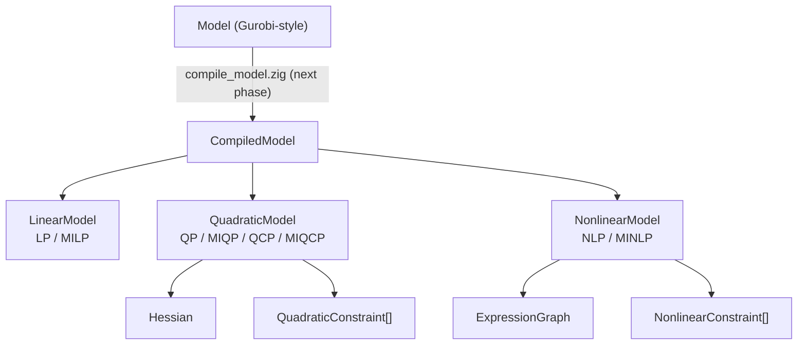

# 核心模型分类体系完成报告

## 1. 审计结果

- **原 lp_model.zig 状态**：工作区未跟踪，尚未存在（前序会话未写入磁盘）。本次直接创建为 `linear_model.zig`。
- **修复的内存/所有权问题**：
  - `LpModel.deinit` 对 allocator 返回的零长度 slice 正确处理（`len > 0` 守卫）。
  - `LinearModelBuilder.freeze()` 在失败路径上不会泄漏（`errdefer csc.deinit()`）。
  - `ExpressionGraphBuilder.freeze()` 修复了 `num_nodes` 在 `toOwnedSlice` 之后读取的错误。
  - `Hessian.diagonal storage` 测试修复了 `initEmpty` 分配被覆盖导致的泄漏。
- **是否保留 LpModel 兼容别名**：不保留。当前工作区无其他代码引用旧名称。
- **未修改区域**：`src/matrix/**`、`bench/matrix/**`、`src/foundation/**`、`src/api/**`、`src/presolve/**`、`src/simplex/**` 全未修改。

## 2. 模型架构



## 3. 修改文件

| 文件 | 变更 | 原因 |
|---|---|---|
| `src/model/linear_model.zig` | 新增 | 核心 LP/MILP 数据结构 |
| `src/model/linear_model_builder.zig` | 新增 | 增量构建 + freeze |
| `src/model/problem_class.zig` | 新增 | ProblemClass + 分类函数 |
| `src/model/hessian.zig` | 新增 | 三角/对角 Hessian 存储 |
| `src/model/quadratic_model.zig` | 新增 | QP/MIQP/QCP/MIQCP 组合 |
| `src/model/expression_graph.zig` | 新增 | 表达式 DAG + evaluator |
| `src/model/nonlinear_model.zig` | 新增 | NLP/MINLP 组合 |
| `src/model/compiled_model.zig` | 新增 | union(enum) 分派 |
| `src/model/validate.zig` | 新增 | 分层验证框架 |
| `src/model/root.zig` | 修改 | 添加新类型导出 |
| `src/model/model.zig` | 修改 | import 路径调整为 `@import("matrix")` |
| `src/model/model_update.zig` | 修改 | import 路径调整 |
| `src/model/model_solve.zig` | 修改 | import 路径调整 |
| `src/root.zig` | 修改 | matrix import 路径调整为 `@import("matrix")` |
| `build.zig` | 修改 | 添加 model_module 和 test-model 步骤 |
| `test/model/root.zig` | 新增 | 模型层测试入口 |
| `todo.md` | 修改 | 更新完成状态 |
| `docs/highs-zhighs-file-map.md` | 修改 | 更新文件对应表 |
| `src/model/issue.md` | 修改 | 更新已知问题 |

## 4. 分类结果

| ProblemClass | 核心结构 | integrality | 触发条件 |
|---|---|---|---|
| LP | LinearModel | null 或全 continuous | 线性目标 + 线性约束 |
| MILP | LinearModel | 至少一个非 continuous | 线性目标 + 线性约束 |
| QP | QuadraticModel | 全 continuous | 二次目标、无二次约束 |
| MIQP | QuadraticModel | 至少一个非 continuous | 二次目标、无二次约束 |
| QCP | QuadraticModel | 全 continuous | 至少一个二次约束 |
| MIQCP | QuadraticModel | 至少一个非 continuous | 至少一个二次约束 |
| NLP | NonlinearModel | 全 continuous | nonlinear objective 或 constraint |
| MINLP | NonlinearModel | 至少一个非 continuous | nonlinear objective 或 constraint |

优先级规则：nonlinear > quadratic constraint > quadratic objective > linear。

## 5. 所有权

| 类型 | 所有权模型 |
|---|---|
| **LinearModel** | 拥有 allocator、col_cost/lower/upper、row_lower/upper、integrality（?[]Integrality）、MatrixStore。`deinit()` 按顺序释放。 |
| **Hessian** | 拥有 starts、indices、values。`deinit()` 释放全部。 |
| **QuadraticConstraint** | 拥有 linear_indices/values、Hessian。`deinit()` 释放全部。 |
| **QuadraticModel** | 拥有 LinearModel、?Hessian、[]QuadraticConstraint。`deinit()` 按依赖顺序释放（constraints → hessian → linear）。 |
| **ExpressionGraph** | 拥有 opcodes、first_child、child_count、children、constants、variables。`deinit()` 释放全部。 |
| **NonlinearModel** | 拥有 QuadraticModel、ExpressionGraph、[]NonlinearConstraint。`deinit()` 按顺序释放。 |
| **CompiledModel** | `union(enum)` — 根据活跃变体分派 `deinit()`。Move-only。 |

## 6. Validation

| Validator | 错误集 | 检查内容 |
|---|---|---|
| `validateLinearModel` | ValidationError | 矩阵结构/维度、成本有限性、bounds 一致性、integrality 长度 |
| `validateHessian` | ValidationError | 三角/对角约束、有限值、递增 indices |
| `validateQuadraticConstraint` | ValidationError | Hessian 有效性、线性 indices 有序唯一、bounds、列范围 |
| `validateQuadraticModel` | ValidationError | 递归调用 Linear + Hessian + Constraint 验证 |
| `validateExpressionGraph` | ValidationError + OutOfMemory | 节点 opcode/arity 一致性、环检测、variable 范围 |
| `validateNonlinearModel` | ValidationError + OutOfMemory | Quadratic + Expression + root 合法性、非空检查 |
| `validateCompiledModel` | ValidationError + OutOfMemory | 分派到活跃变体的 validator |

## 7. 测试

- **test-model w32**：✓ 通过（无输出）
- **test-model w64**：✓ 通过
- **test-matrix w32**：✓ 通过
- **test-matrix w64**：✓ 通过
- **全量测试**：✓ 216/216 通过
- **testing allocator**：✓ 无泄漏
- **git diff --check**：✓ 无 whitespace 错误

## 8. API 稳定性

| API | 状态 | 说明 |
|---|---|---|
| `ProblemClass` / `classify()` | Experimental | 枚举成员可能在新增类型时扩展 |
| `LinearModel` | Experimental | 字段布局可能在 presolve 集成时修正 |
| `LinearModelBuilder` | Experimental | setter 签名可能在扩展时调整 |
| `Integrality` | Experimental | 枚举值稳定 |
| `Hessian` / `HessianFormat` / `Curvature` | Experimental | `Curvature` 分析尚未实现 |
| `QuadraticModel` / `QuadraticConstraint` | Experimental | 约束批量存储可能转为 SoA |
| `ExpressionGraph` / `NodeId` / `Opcode` | Experimental | Opcode 集可能扩展 |
| `NonlinearModel` / `NonlinearConstraint` | Experimental | 组合方式稳定 |
| `CompiledModel` | Experimental | clone() 待实现 |
| `SolverCapability` | Experimental | bit 位置稳定 |
| `ValidationError` + validators | Experimental | 错误集可能细化 |

## 9. 尚未支持的求解能力

以下模型类型可以**表达**但当前求解器无法**求解**：

- **QP/MIQP**：QuadraticModel + Hessian 可表达二次目标，但无 QP 求解器接入。
- **QCP/MIQCP**：QuadraticModel 可存储二次约束，但无 QP 求解器。
- **NLP/MINLP**：NonlinearModel + ExpressionGraph 可表达非线性问题，但无 NLP 求解器。

已接入的求解路径：

- **LP**：`Model.optimize` 分派到 simplex 引擎。
- **MILP**：`Model.optimize` 经 `src/model/model_solve.zig` 分派到 `src/mip/root.zig` 的 branch-and-bound 求解器，目标值、对偶界、节点数与解均可用。MIP 安全 presolve 已接入（`presolve.PresolvePipeline.initMip`，仅应用整数安全的化简，`Presolve=0` 可关闭）。遗留缺口：MIP 回调仍为 stub。

`SolverCapability` 机制可以查询哪些类支持求解。

## 10. 已知风险

### P0 — 必须在本轮修复
- 无。所有权链经 `testing.allocator` 验证无泄漏。

### P1 — 重要但不阻塞审核
- `NonlinearModel` 在 `nonlinear_objective == null && nonlinear_constraints.len == 0` 时分类仍为 NLP；调用者需使用 `hasNonlinearRoot()` 检查。这是组合类型系统的固有折中。
- `validateExpressionGraph` 可能返回 `OutOfMemory`（来自环检测的临时分配），调用者需正确处理。
- `var`/`const` 在 Zig 0.16.0 中更严格；测试代码需使用 `var` 变量配合 `defer` 进行清理。

### P2 — 低优先级/后续优化
- `QuadraticConstraint` 当前为 `slice-of-structs`；若约束数量很大应考虑 SoA 布局。
- `ExpressionGraph` 的 `evaluate()` 仅为参考实现，不应用于性能敏感路径。
- `Clone` 未实现；`CompiledModel` 为 move-only。
- 凸性检测（特征值分析）未实现；`Curvature` 默认为 `.unknown`。

## 11. 下一阶段

仅规划，不执行：

1. **Presolve 接入** — ~~LP/MILP 求解路径接入~~（已完成：LP 经 `LpSolveSession`，MILP 经 `model_solve.zig` 的 MIP 安全 pipeline）。剩余方向：更强的 MIP 化简规则（probing、系数收紧等）。
2. **MIP 回调接入** — `cbCut` / `cbSolution` / `cbGet` 等回调目前为 stub，MILP solver 就位后可接通。
3. **QP 求解路径** — Active-set 或 barrier QP solver；QuadraticModel 数据层已完整。
4. **ExpressionGraph 增强** — 自动微分、区间传播、求值缓存。

已完成：`compile_model.zig` 编译路径、Solution/Basis/Info 结构、求解 dispatcher（LP → simplex，MILP → `src/mip` branch-and-bound）。

## 11.5 MIP 求解器进展（本轮）

- **conflict_pool 测试修复**：`src/mip/conflict_pool.zig` 的两个 path-learning 测试此前用 `arena.append`（reason `.unspecified`）追加变更，而 `learnPath` 只收集 `.branch` 原因的变更（no-good 语义只包含分支决策）。修正测试改用 `appendWithReason(..., .branch)`，与 `src/mip/node.zig` 中 `childWith` 的真实用法一致。`zig build test` 287/287 全绿。
- **Pseudocost branching**：已就位并作为 `src/mip/search.zig` 的默认分支插件（`src/plugins_builtin/branching.zig` 的 `Pseudocost`，历史在 `src/mip/pseudocost.zig`，经 `BranchingContext.pseudocost_scores` 只读投影传入，契约无需扩展）。打分用 down/up 增益乘积，历史不足时由全局平均单位退化量兜底（等价 balanced most-fractional）。本轮补齐端到端对比测试（`search.zig` 中 pseudocost vs most-fractional：同最优值、节点数不劣、观测数 > 0），并在 `bench/mip/solver_bench.zig` 增加 `most-fractional` profile 便于手工对比。
- **手工 MIP 对比**（`bench/mip/branching_compare.lp`，16 二进制变量/10 约束，propagation 与 strong branching 关闭）：pseudocost 33 节点 vs most-fractional 31 节点，目标值一致（44.0），pseudocost 观测 27 次——插件生效，小规模实例两者基本相当。
- **既有缺陷已修复（本轮）**：更大随机实例（22 变量/14 约束，seed 7，已固化为 `bench/mip/random_22x14_seed7.lp` 与 `test/model/data/warm_restart_mip.lp`）在 dual simplex 热启动路径触发 `src/lp/simplex/engine_dual.zig:530` 的 index out of bounds（panic 信息 `index 43, len 36`；43 = 22+14+7 恰为 Phase I 人工列索引）。根因：strong branching 探针（`src/mip/strong_branching.zig` 的 `probe`，`max_iterations_per_probe=20`）在 primal Phase I 中途达到迭代/工作量上限返回时，`cleanupArtificialBasis` 尚未执行，引擎保留的 basis 中仍有人工列 basic；`LpSolveSession.solveReduced` 仅凭维度与 revision 戳判定可复用，`refreshProblemStorage` 又只校验维度而不校验 `basic_index` 范围，于是下一次 `reoptimizeProblem` 带着含人工列索引的 basis 进入 dual 循环，用人工列索引（≥ num_cols+num_rows）去索引仅覆盖原始列的 `work.lower/upper` 而越界。修复：`src/lp/simplex/engine_setup.zig` 的 `refreshProblemStorage` 在维度校验之后、任何状态改写之前，拒绝仍含人工列 basic 的保留 basis（返回 false 走冷启动）。回归测试：`src/lp/simplex/engine_setup.zig` 新增单元测试（中断的 Phase I 留下人工 basic → 门禁拒绝 → 重优化冷启动并求得正确解），`test/model/root.zig` 新增端到端测试（warm_restart_mip 求解至 optimal，目标值 63.0 与对偶界一致；default 与 no-cuts profile 交叉验证一致）。修复后该实例 CLI 求解 OPTIMAL 63.0（39 节点），branching_compare.lp 结果不变（44.0，32 节点，与未修复版本一致——报告中此前的 33 节点为更早提交的计数）。另观察到 `most-fractional` profile 在该实例上以 numerical_failure 结束（修复前后均如此，strong branching 关闭，与本次 bug 无关），建议另行排查。

## 11.6 MIP 求解器进展（本轮）：most-fractional numerical_failure 修复 + MIP 回归基准套件

- **根因**：`bench/mip/random_22x14_seed7.lp` 在 `most-fractional` profile（propagation/strong branching 关闭）下于第 41 个节点以 `numerical_failure` 结束（`failure_site=ratio_test`，warm dual reoptimization）。用全新 `LpSolveSession` 冷解同一节点 LP 证明其 **infeasible**——是 dual simplex 未能出具不可行证书，而非模型状态误映射。具体机制：`src/lp/simplex/engine_dual.zig` 的 solveDualLoop 精确成本路径中，CHUZC "无入基候选" 判定只在基刚重建（`fresh_no_entering_basis`）时才允许用 `buildAndValidateInfeasibilityRay` 出具 Farkas 证书，且 rebuild-refresh 恢复每次求解仅允许一次（`no_entering_recovery_used`）。该节点求解中第一次"无入基"是陈旧因子链的误判（rebuild 后正常入基并继续 pivot），随后真正的不可行 no-entering 出现时 fresh 标志已被中间 pivot 清除、恢复额度已用尽，于是保守返回 `numerical_failure`。
- **修复**（`src/lp/simplex/engine_dual.zig`）：精确成本 no-entering 路径改为"非 fresh 即先 rebuild-refresh 再信任判定"，用 `no_entering_exact_rebuilds` 计数器（上限 2）只约束**连续无 pivot** 的 rebuild 次数；一旦有入基候选被接受（或 shifted cleanup 边界重置）即清零。fresh 状态下的证书出具逻辑不变（仍在原始坐标系验证 Farkas 证明，验证不过仍返回 numerical_failure），不削弱原有保守性。修复后 most-fractional profile 得 63.0（92 节点），与 default profile（39 节点，63.0）一致；branching_compare.lp 结果不变（44.0）。
- **回归测试**：新增 `test/mip/regression.zig`（build step `test-mip-regression`，已挂入 `zig build test`），8 个已知最优解实例 × 4 个 profile（default / no-cuts / no-propagation / most-fractional），逐一断言 status=optimal 且 ObjVal/ObjBound 与参考值 1e-6 内一致。most-fractional profile 用例即本 bug 的回归测试。
- **基准实例清单**（参考最优值）：`test/model/data/tiny_mip.mps`=3，`test/model/data/presolve_mip.mps`=6，`test/model/data/warm_restart_mip.lp`=63，`bench/mip/branching_compare.lp`=44，`bench/mip/random_22x14_seed7.lp`=63，新增 `test/mip/data/knapsack_6.lp`=47（二进制背包，暴力枚举验证）、`test/mip/data/set_cover_5.lp`=7（集合覆盖，暴力枚举验证）、`test/mip/data/mixed_int_3.lp`=5.5（二进制+整数+连续混合，暴力枚举验证）。
- **验证**：`zig build` / `zig build test` 全绿（含新套件 4/4）；bench 全部 7 个 profile × 2 实例均 optimal 且目标值正确；CLI 求解不变。

## 12. Git 状态

```
 M build.zig
 M docs/highs-zhighs-file-map.md
 M src/model/constraint/array.zig        (zig fmt)
 M src/model/constraint/index.zig        (zig fmt)
 M src/model/env.zig                     (zig fmt)
 M src/model/genconstr/array.zig         (zig fmt)
 M src/model/issue.md
 M src/model/model.zig                   (import 路径修改)
 M src/model/model_solve.zig             (import 路径修改)
 M src/model/model_update.zig            (import 路径修改)
 M src/model/qconstr/array.zig           (zig fmt)
 M src/model/root.zig
 M src/model/sos/array.zig               (zig fmt)
 M src/model/var/index.zig               (zig fmt)
 M src/root.zig                          (import 路径修改)
 M todo.md
?? src/model/compiled_model.zig
?? src/model/expression_graph.zig
?? src/model/hessian.zig
?? src/model/linear_model.zig
?? src/model/linear_model_builder.zig
?? src/model/nonlinear_model.zig
?? src/model/problem_class.zig
?? src/model/quadratic_model.zig
?? src/model/validate.zig
?? test/model/
```

**确认没有修改 matrix/api/presolve/simplex** 目录下的任何文件。
